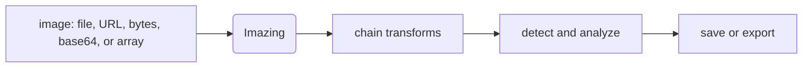

<picture>
  <source media="(prefers-color-scheme: dark)" srcset="assets/banner-dark.svg">
  <source media="(prefers-color-scheme: light)" srcset="assets/banner-light.svg">
  
</picture>

**load → transform → detect → save, one call each, no boilerplate glue in between.**

<div align = "center">
<!-- [](https://pypi.org/project/imazing/) -->
<!-- [](https://pypi.org/project/imazing/) -->
<!-- [](https://test.pypi.org/project/imazing/) -->
[](https://github.com/MeetRVyas/imazing/actions/workflows/ci.yml) [](LICENSE)
<!-- [](https://test.pypi.org/project/imazing/) -->

[](https://github.com/MeetRVyas/imazing/actions/workflows/ci.yml) [](https://opencv.org/) [](LICENSE)

</div>

## Why this exists

OpenCV workflows tend to accumulate the same handful of steps: load an image, transform it, filter it, run some detection, pull the result back out. Doing that in raw OpenCV means rewriting loader boilerplate and re-wiring the same four or five calls in every script. Imazing wraps those steps behind one object with a chainable API, so a five-step pipeline reads as one expression instead of five separate ones, and a CLI covers the common cases when opening Python isn't worth it.

## See it work

```
[demo: before/after image strip or a short terminal recording goes here]
```
<sub>Quickest path: run the Quick start commands below through `vhs` or `asciinema`, or drop in a before/after PNG pair.</sub>

## Features

- **Chainable by design.** Every call returns the same object, so `resize().blur().adjust_brightness_contrast().save()` reads like a pipeline, not a script.
- **Loads from anywhere.** Local files, URLs, raw bytes, base64 data URIs, or NumPy arrays, with Unicode paths handled.
- **Detection built in.** Haar-cascade face detection, contour detection, template matching, and QR/barcode decoding, no extra wiring.
- **OCR through Tesseract.** Pull text off an image with one call, once the `ocr` extra is installed.
- **A CLI for the quick jobs.** `imazing resize`, `convert`, `blur`, `edges`, `faces`, `ocr`, and `qr` cover the cases where a whole Python file feels like overkill.

## Quick start

```bash
pip install imazing
```

Optional extras (`ocr`, `qr`, `desktop`, or `full` for all of them):

```bash
pip install "imazing[full]"
```

```python
from imazing import Imazing

(
    Imazing("photo.jpg")
    .resize(width=800)
    .blur(method="gaussian", ksize=5)
    .adjust_brightness_contrast(alpha=1.1, beta=10)
    .save("photo_edited.jpg")
)
```

```bash
imazing resize photo.jpg out.jpg --width 800
imazing info photo.jpg
imazing --help
```

For development: `pip install -e ".[dev]"`, then `pytest -q`.

## How it fits together



One object, one entry point. What happens between B and E is just method calls, in whatever order the pipeline needs.

## Tech stack

Python 3.9+, built on OpenCV and NumPy. Requests for network loading, Typer for the CLI. Optional: Tesseract OCR, pyzbar (QR/barcode), PyAutoGUI (screen, clipboard, webcam capture), Pillow. Tested with pytest.

## Status

Stable, v1.0.0. Packaged library and CLI, CI across Python 3.9 to 3.12, full docs and changelog, 137 passing tests.

---


That QR code decodes the same way any other one does here: `imazing qr screenshot.png`.

---

## Contributing

Issues and PRs welcome. Run `pytest -q` before opening one.

## License

MIT. See [LICENSE](LICENSE).
